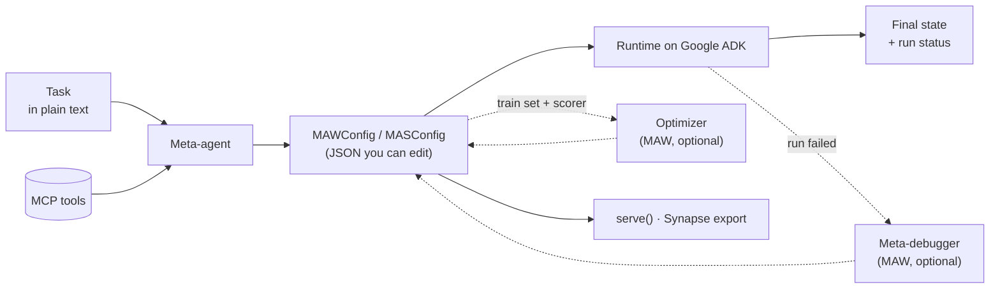
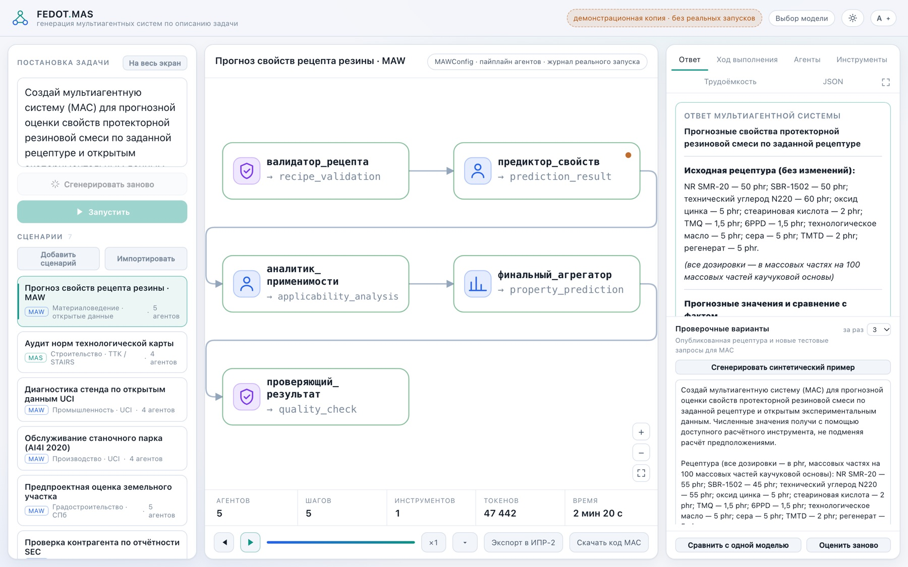

<div align="center">


# `FEDOT.MAS`

**Multi-agent systems generated from a plain-text task description**

[](https://itmo.ru/)
[](https://github.com/ITMO-NSS-team/FEDOT.MAS/actions/workflows/test.yml)
[](pyproject.toml)
[](LICENSE)
[](https://google.github.io/adk-docs/)

</div>

## Overview

You describe a task. A **meta-agent** designs a team of agents for it — roles, prompts,
models, tools and the order they work in — and FEDOT.MAS runs that team on
[Google ADK](https://google.github.io/adk-docs/). It can also repair a failed run and
evolve the agents' prompts against your own scoring. The design is plain JSON you can
read, edit, save, serve or hand to another platform.

### How it works



## Quick start

**1. Install.** FEDOT.MAS is not on PyPI yet. Install it from source with [uv](https://github.com/astral-sh/uv)
and, optionally, [just](https://github.com/casey/just):

```sh
git clone https://github.com/ITMO-NSS-team/FEDOT.MAS.git && cd FEDOT.MAS
just venv        # or: uv sync && cp -n .env.example .env
just mcp-sync    # build the MCP servers once, or the first run can time out
just doctor      # check which tools are ready and what the others need
```

**2. Configure.** Fill in `.env`:

```env
OPENAI_API_KEY=sk-or-...
OPENAI_BASE_URL=https://openrouter.ai/api/v1
FEDOTMAS_DEFAULT_MODEL=openai/gpt-5-mini  # set it, the built-in default model is private
```

**3. Run.** Save this as `quickstart.py` in the repository root:

```python
import asyncio
from fedotmas import MAW

async def main():
    maw = MAW(mcp_servers=["sandbox-light"])
    state = await maw.run("How many prime numbers are below 10,000? Check it by computation.")
    print(maw.generated_config.model_dump_json(indent=2))  # the team the meta-agent designed
    print(state)                                            # shared state: each agent's output by its output_key

asyncio.run(main())
```

```sh
uv run python quickstart.py
```

## Table of Contents

- [Core features](#core-features)
- [Usage](#usage)
- [Web GUI](#web-gui)
- [Optimizing a system](#optimizing-a-system)
- [Documentation](#documentation)
- [Contributing](#contributing)
- [Contacts](#contacts)
- [Citation](#citation)

## Core features

- **Two orchestration modes** — `MAW`, a fixed workflow (sequential, parallel, loop), or `MAS`, a coordinator that routes work to workers.
- **Tools over [MCP](mcp-servers/README.md)** — web search, scraping, browsers, code sandboxes, document and media readers, or any MCP server by URL.
- **Dependable runs** — runtime guards and an explicit status for every run. In `MAW`, handoffs between agents are checked and the final agent may abstain instead of guessing.
- **Self-healing** — the [meta-debugger](docs/debugger.md) fixes a failed `MAW` configuration and retries.
- **Optimizer** — GEPA-style evolution of `MAW` agent instructions against your tasks and scorer.
- **Web GUI** — a demo app that builds a system for a task and shows it working live.
- **Deploy and export** — serve a system as an ADK API server, or [export a `MAW` config to Synapse](docs/synapse-export.md).
- **Providers** — any OpenAI-compatible endpoint, or a Codex CLI subscription (`codex/...` models after `codex login`).
- **Tracing** — full execution traces in [Langfuse](docs/langfuse.md).

## Usage

**Two modes, three ways to work.** `MAW` runs agents in a fixed order, while `MAS` lets a
coordinator pick the worker. Either can generate and run, generate for review, or run
your own config:

```python
state = await maw.run(task)                      # generate and run

config = await maw.generate_config(task)         # generate, inspect or edit, then run
state = await maw.build_and_run(config, task)

state = await maw.build_and_run(my_config, task) # your own MAWConfig (or MASConfig with MAS)
```

## Web GUI

<div align="center">
  
  <br><sub>A recorded run: five agents predict tire-rubber properties with a MAPE of 3.2% on a held-out published recipe (a retrospective check, not a lab test).</sub>
</div>

<br>

The [demo app](gui/README.md) (Russian UI) generates a system for a task, draws its
graph, streams the run, and compares the answer with a single model through a judge.

```sh
uv pip install -r gui/requirements.txt
uv run python gui/run.py   # http://localhost:4173
```

The GUI uses OpenRouter models by default, so it needs `OPENROUTER_API_KEY` in `.env`
or entered in the app.

> [!CAUTION]
> A demo, not a production service: in public mode anyone with the link runs agents on
> your machine. Read the [GUI README](gui/README.md) before sharing it.

## Optimizing a system

The [optimizer](docs/optimizer.md) follows [GEPA](https://arxiv.org/abs/2507.19457): an
LLM explains why a candidate failed and rewrites the agents' instructions.

```python
from fedotmas import Optimizer
from fedotmas.optimize import Task

trainset = [Task("Explain quantum computing basics"), Task("Describe how neural networks learn")]
opt = Optimizer(maw, criteria="Clarity, accuracy, completeness")
result = await opt.optimize(trainset, seed_config=config)  # config from generate_config
print(result.best_score, result.best_config)
```

On AIME 2025 (30 problems, `gpt-oss-120b`), optimizing a single-agent seed generated by
the meta-agent raised accuracy from 74.7% to 80.0% in one 2000-evaluation run. A
hand-written seed reached 82.0% ([details](benchmarks/aime_math/README.md#reference-results)).

## Documentation

- [MAW and MAS guide](docs/index.md) — pipeline types, two-step runs, handcrafted configs
- [Meta-debugger](docs/debugger.md) — recovery from failed runs with `Controller.run_with_recovery`
- [Step-by-step control](examples/control/) — run a `MAW` pipeline agent by agent and inspect the state
- [Optimizer](docs/optimizer.md) — scorers, strategies, checkpoints, synthetic test inputs
- [Synapse export](docs/synapse-export.md) — generating against another platform's tools and agents, then exporting
- [Deployment](examples/deployment/) — serving `MAW` and `MAS` over the ADK API server
- [Langfuse](docs/langfuse.md) — execution traces
- [MCP servers](mcp-servers/README.md) — discovery, transports, adding your own server
- [Web GUI](gui/README.md) — demo app, public mode, API (in Russian)
- [Examples](examples/) — runnable scripts: workflows, routing, recovery, optimization, deployment, tools
- [Benchmarks](benchmarks/) — GAIA, AIME and HotpotQA runners

## Contributing

Report bugs and propose changes in [issues](https://github.com/ITMO-NSS-team/FEDOT.MAS/issues).
Set up with `just venv-dev`, and run `just check` and `just test-unit` before a pull request.

## Contacts

- [Natural Systems Simulation Lab](https://itmo-nss-team.github.io/) website
- [Telegram channel](https://t.me/NSS_group) of the lab

## Citation

```bibtex
@software{fedotmas2026,
  title  = {{FEDOT.MAS}: Multi-agent systems generated from a plain-text task description},
  author = {{Natural Systems Simulation Lab}},
  year   = {2026},
  url    = {https://github.com/ITMO-NSS-team/FEDOT.MAS}
}
```
